# XLSX Viewer, Excel Viewer, CSV Viewer & Parquet Viewer (XLS, CSV Preview)

<a href="https://marketplace.visualstudio.com/items?itemName=zovo.table-viewer-vscode"></a>
<a href="https://marketplace.visualstudio.com/items?itemName=zovo.table-viewer-vscode"></a>

Free, no sign-in, works offline. No paywall, no ads, no license banner, no evaluation popup and no account. There is nothing to buy. SQL queries, the SQL filter, column stats and export are free too.

An XLSX viewer, Excel viewer, CSV viewer and Parquet viewer for VS Code, with SQL. It shows Excel, CSV and Parquet files as a sortable, filterable table, even at 1,000,000 rows, and since 0.5 it runs SQL on CSV, Excel and Parquet: query a CSV with GROUP BY and JOIN, even a big CSV of several GB that the table can't hold. No Python, no database to install, and nothing goes over the network.


*A real VS Code 1.142 window. The 250 MB CSV (4,283,297 generated taxi trips) is past the table's 1,000,000-row limit, so the table shows the first part and the query reads the whole file as a stream: 3.1 s on an M-series Mac.*

## SQL queries on CSV, Excel and Parquet (new in 0.5)

Click Query in the toolbar, write a SELECT, press Ctrl+Enter (Cmd+Enter on a Mac).

```sql
SELECT c.country, COUNT(*) AS orders, ROUND(SUM(o.amount), 2) AS revenue
FROM this o
JOIN 'customers.parquet' c ON o.customer_id = c.id
WHERE o.status = 'paid'
GROUP BY c.country
ORDER BY revenue DESC
```

- Real SQL: column lists, expressions and aliases, WHERE, GROUP BY with COUNT, SUM, AVG, MIN, MAX, COUNT(DISTINCT), MEDIAN and GROUP_CONCAT, HAVING, ORDER BY, LIMIT, DISTINCT, CASE, CAST, subqueries in FROM, and about 70 text, number and date functions (LOWER, SUBSTR, REPLACE, ROUND, COALESCE, STRFTIME, DATE_TRUNC, YEAR, DATE_DIFF and more).
- JOIN: `FROM this` is the open file. Join another sheet of the same workbook by name (`JOIN "Customer List" c ON ...`) or another CSV, TSV, Excel or Parquet file of the workspace by path in single quotes. INNER, LEFT and CROSS joins.
- Big CSV files: a CSV is read as a stream and a Parquet file one row group at a time, with only the columns the query uses. GROUP BY keeps one row per group, so a large CSV of many GB can be aggregated. Parquet row groups whose min/max statistics rule out the WHERE condition are skipped.
- Progress in rows per second and a Cancel button. A query that would need too much memory stops with a message that says what to change, instead of freezing VS Code.
- The result opens in the same grid: sort, filter, stats, copy and Save result as CSV, TSV, JSON, JSON Lines or Parquet. Back to file shows the file again.
- History per file and Copy query. Only SELECT runs: the viewer never writes to the file you query.

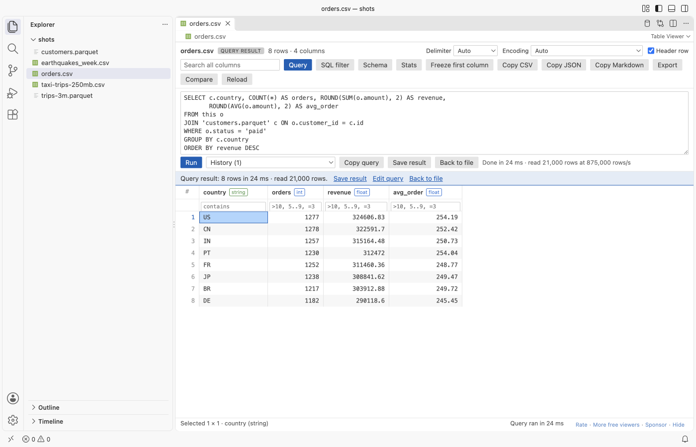

*A CSV joined with a Parquet file in a real VS Code window, light theme. The same query gives the same numbers as Python's csv module with pyarrow.*

## Why this one

These are problems people reported with other CSV and Excel tools in VS Code, and what this extension does about them. Each point was measured in a real VS Code window.

- Queries on big files. A text-based CSV tool works on the file as a text document, and VS Code does not give extensions text documents over 50 MB. Users report that the query window does not open for a 60 MB CSV ([issue 118](https://github.com/mechatroner/vscode_rainbow_csv/issues/118), [issue 153](https://github.com/mechatroner/vscode_rainbow_csv/issues/153)). This extension reads the file from disk in a background thread: a GROUP BY over a 250 MB CSV with 4.3 million rows took about 3 s, and the scan added about 100 MB to the extension host's memory. In a test outside VS Code the same engine aggregated a 5 GB CSV (98 million rows) with a peak of 280 MB.
- License banners and evaluation popups. Reviews of a popular Excel and CSV viewer from 2024 to 2026 complain about a license banner, an evaluation popup and features that need payment ([reviews](https://marketplace.visualstudio.com/items?itemName=GrapeCity.gc-excelviewer&ssr=false#review-details)). Here there is no banner, no popup, no trial and no account, and SQL is free.
- Slow previews of large tables, no row count. The same reviews say large tables take long to preview and the number of rows and columns is hard to see. Here the first rows show while the rest load, the toolbar shows the row and column count, and a file past the limits opens with a "Query the whole file" link that counts every row.

New in 0.4:

- Big Excel files open fast. In a real VS Code window, a 48 MB workbook with 660,000 rows showed its first rows in 0.5 s and finished loading in 3.4 s. Version 0.3 took 10 s before it showed anything, and the extension host used 1.3 GB. Now it uses about 0.5 GB.
- Formulas: the cell panel shows the formula of the cell (`=SUM(B2:B9)`) next to its result, and "Formulas: on" in the toolbar shows every formula in the grid, like Ctrl+` in Excel. Error cells show `#DIV/0!` and `#N/A` as Excel does, and a formula with no saved result shows the formula instead of an empty cell.
- Copy Markdown: copies the selection (or the whole view) as a Markdown table, as it looks on screen, ready for a README, an issue or an AI chat.
- Freeze first column: keeps the first column in view while you scroll sideways. The header row always stays in view.
- Free for everyone: the SQL `WHERE` filter, column stats (count, nulls, distinct, min, max, mean, top values) and export to CSV, TSV, JSON or JSON Lines. They were planned as paid features. Now nothing is locked.
- Encoding: CSV files in Shift_JIS, GB18030, Big5, EUC-KR, Windows-1251 and UTF-16 without a byte order mark are detected, and an Encoding list in the toolbar reads the file in any of 13 encodings.

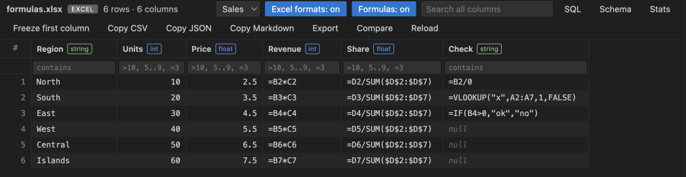

*"Formulas: on" in a real VS Code 1.142 window. Switched off, the same cells show $25.00, 2.5% and `#DIV/0!`.*

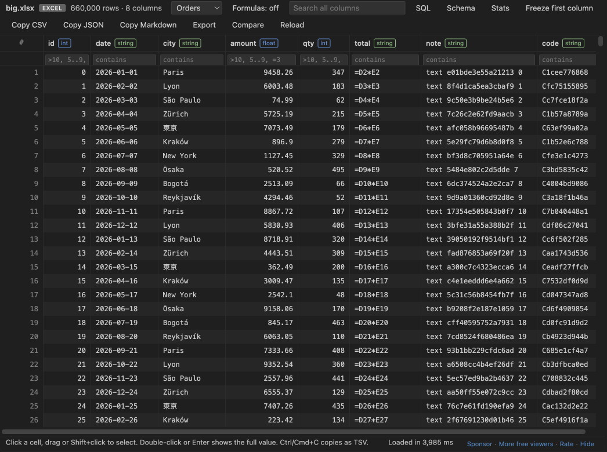

*A generated 48 MB workbook (660,000 rows, written by openpyxl without saved formula results) in a real VS Code window on an M-series Mac. The first rows showed after 0.6 s.*

New in 0.3:

- Excel number formats: cells look the way Excel shows them: 25.0%, $1,234.50, 1,234,567 and the dates in their own format. Sort, filters and copy still use the stored values, and the cell panel shows both.
- Compare with Git HEAD: see which rows of a CSV, Excel or Parquet file changed since the last commit, in VS Code's diff editor. You can also compare two table files.
- Auto-reload: when a script, `git pull` or an AI agent rewrites the file, the table reloads by itself and keeps your sort, filters and sheet.

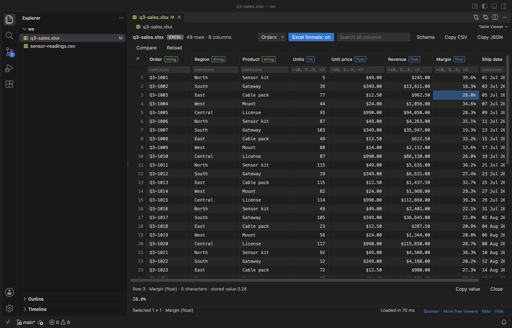

*A real VS Code 1.142 window running this extension on a generated sales workbook (49 orders, 2 sheets). The "Excel formats: on" switch is in the toolbar.*

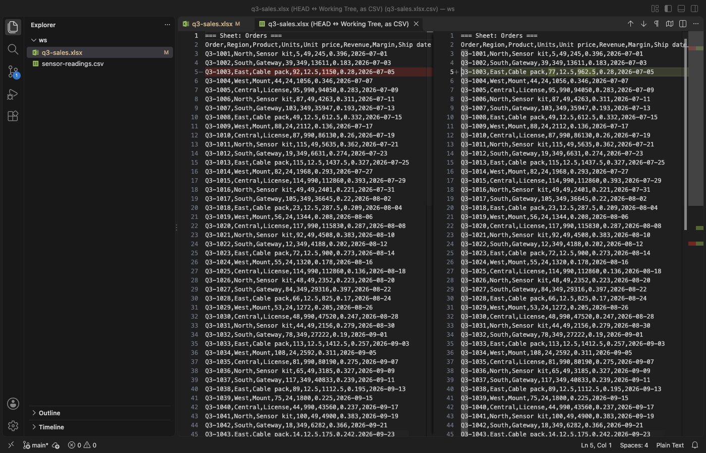

*Compare with Git HEAD on the same workbook after an edit. Each sheet is a section, and changed, added and removed rows are marked.*

- Opens fast. Rows are read in a background thread and only the rows and columns on screen are drawn, so VS Code doesn't freeze, even on a file with 5,000 columns. A big CSV or Excel file shows its first rows while the rest load, and a Parquet file with several row groups shows the first group early.
- No Python, no kernel, no account. It's plain JavaScript that runs offline and sends nothing anywhere.
- Answers the usual questions in one place. You get the column types, the row count, the full Parquet schema, sort, filter, a SQL filter, SQL queries with GROUP BY and JOIN, column stats, copy as CSV, JSON or Markdown, export, and the full text of any cell with its JSON indented.

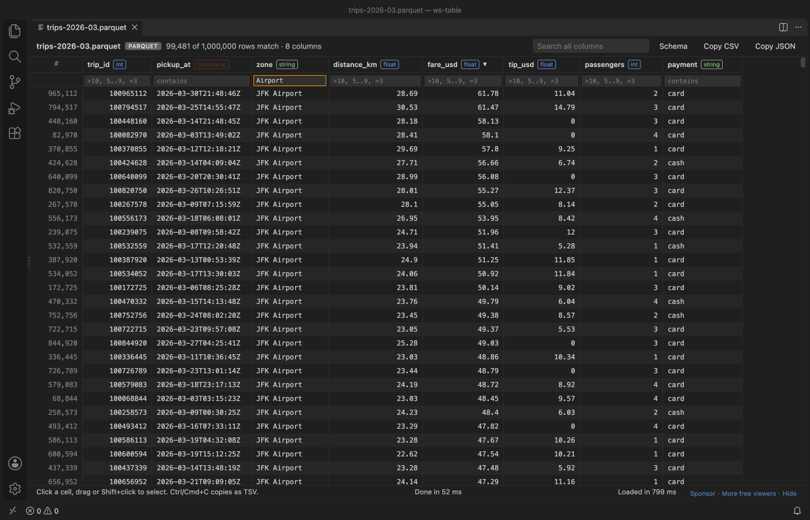

*A real VS Code 1.142 window running this extension on a generated 1,000,000 row taxi-trip Parquet file (12 MB, zstd, made by [`scripts/screenshot/make_trips.py`](https://github.com/theluckystrike/table-viewer-vscode/blob/main/scripts/screenshot/make_trips.py)). It loaded in 0.8 s on an M-series Mac.*

## Quick start

1. Install Table Viewer and click any `.parquet`, `.xlsx`, `.xls` or `.ods` file. It opens as a table.
2. For a `.csv` or `.tsv` file, click the table icon at the top right of the editor (or right-click the file and pick "Open in Table Viewer").

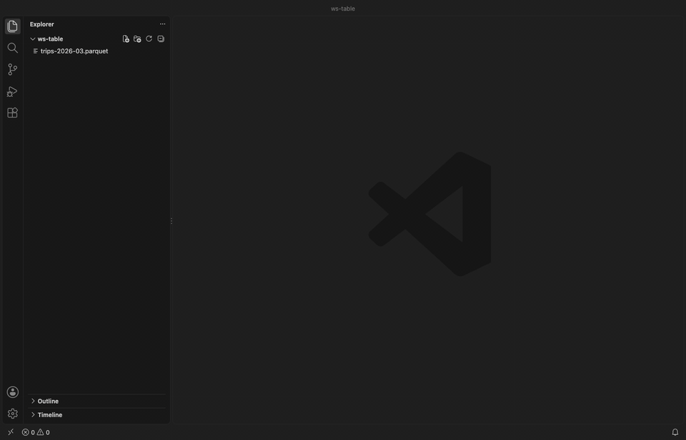

*Recorded in the same window. The white arrow is drawn in to show where each click lands.*

Run "Table Viewer: Get Started" from the Command Palette for a short tour.

## What you can do

Click a column header to sort it. Clicks cycle through ascending, descending and the file's own order. Nulls always go last.

Type in the box under a header to filter that column. Number columns take `>10`, `>=10`, `<5`, `=3`, `!=3` and ranges like `5..9`. Text columns match any part of the text, `=word` matches exactly and `!word` drops rows that contain it. `empty` and `!empty` work everywhere. The search box at the top looks in every column at once.

Drag or Shift+click to select cells. Click row numbers to select whole rows, or the `#` corner (or Ctrl+A) to select everything. "Copy CSV" copies the selection with a header row, and "Copy JSON" copies an array of objects that keeps numbers, booleans and nested values as JSON. "Copy Markdown" copies a Markdown table of the cells as shown, with number columns right-aligned. Ctrl+C (Cmd+C on macOS) copies plain tab-separated values, which paste straight into Excel or Google Sheets as cells. With nothing selected, the copy buttons take the whole filtered view.

"SQL" opens a `WHERE` box that filters all rows, for example `fare > 20 AND (city = 'Paris' OR city LIKE 'Lon%') AND tip IS NOT NULL`. "Stats" shows count, nulls, distinct values, min, max, mean and the top values of each column for the rows in view. "Export" saves the rows in view, filtered and sorted, as CSV, TSV, JSON or JSON Lines.

"Freeze first column" keeps the first column on screen while you scroll to the right. The column names and filter boxes always stay at the top.

Double-click a cell, or press Enter, to open the cell panel under the table. It shows the whole value, wrapped, even past the 2,000 characters a grid cell shows. JSON objects and arrays are indented, and "Raw" shows the text as it is in the file. The panel follows the arrow keys, "Copy value" copies what it shows, and Esc closes it.

Double-click the edge of a column header to fit the column to the rows loaded so far.

## Excel number formats

Excel stores 0.25 and shows 25%. Table Viewer shows the cell the way Excel does, using the number format saved in the workbook: percentages, currency, thousands separators, decimals and custom date formats. Formula cells show the result Excel saved with the file, and error cells show `#DIV/0!`, `#N/A` or `#REF!`.

"Formulas: on" in the toolbar shows the formula text of every formula cell instead of its result. Shared formulas show the formula of each cell, with its own references. A formula that was never calculated (a file written by a script and not opened in Excel since) shows its formula instead of an empty cell.

- Sort and the number filters (`>0.2`, `5..9`) use the stored values, so a column of percentages sorts as numbers.
- The search box finds both the stored value and the text as shown, so `$1,234` finds the cell.
- Copy CSV, Copy JSON and Ctrl+C copy the stored values, so numbers paste into a spreadsheet as numbers.
- The cell panel (double-click a cell) shows the text and, next to it, the stored value and the formula.
- "Excel formats: on" in the toolbar switches one tab to the stored values. The setting `tableViewer.excelFormats` sets the default.
- Dates in Excel's default short date format (m/d/yy) stay as ISO dates such as 2024-01-15, because Excel shows that format in each reader's own locale.

## Compare with Git HEAD or another file

Right-click a `.csv`, `.tsv`, `.xlsx`, `.xls`, `.ods` or `.parquet` file and pick "Compare with Git HEAD", or use the Compare button in the table's toolbar. Table Viewer reads the committed version with `git cat-file` and opens both versions as CSV text in VS Code's diff editor, so changed, added and removed rows are marked. An Excel workbook gives one section per sheet.

"Compare with Another Table File..." does the same for any two table files, for example last week's export and this week's. Select two files in the Explorer first and it compares those two. The command also shows in the Source Control view for changed data files.

- The diff uses stored values, not the display text, so a change from 0.251 to 0.25 shows even when both display as 25%.
- Each table is compared up to 100,000 rows (setting `tableViewer.maxCompareRows`). Past that, the text ends with a note.
- Git runs on your machine with repository hooks switched off. It needs a trusted workspace. A file stored in Git LFS shows a note instead of a diff of the pointer file.

## Auto-reload when the file changes

Table Viewer watches the open file. When a script, a notebook, `git pull` or an AI agent writes it again, the table reloads within about half a second:

- The sort, the column filters, the search and the Excel sheet stay. Columns are matched by name, so they survive a column that moved.
- The old rows stay on screen until the new ones are ready, so the table never goes blank.
- The status bar says "Reloaded: the file changed on disk (1,000 → 1,250 rows)".
- If the file is half written and can't be read, the last good table stays, and the next change tries again.
- The Reload button in the toolbar reads the file on request. Set `tableViewer.autoReload` to `false` to reload only with the button.

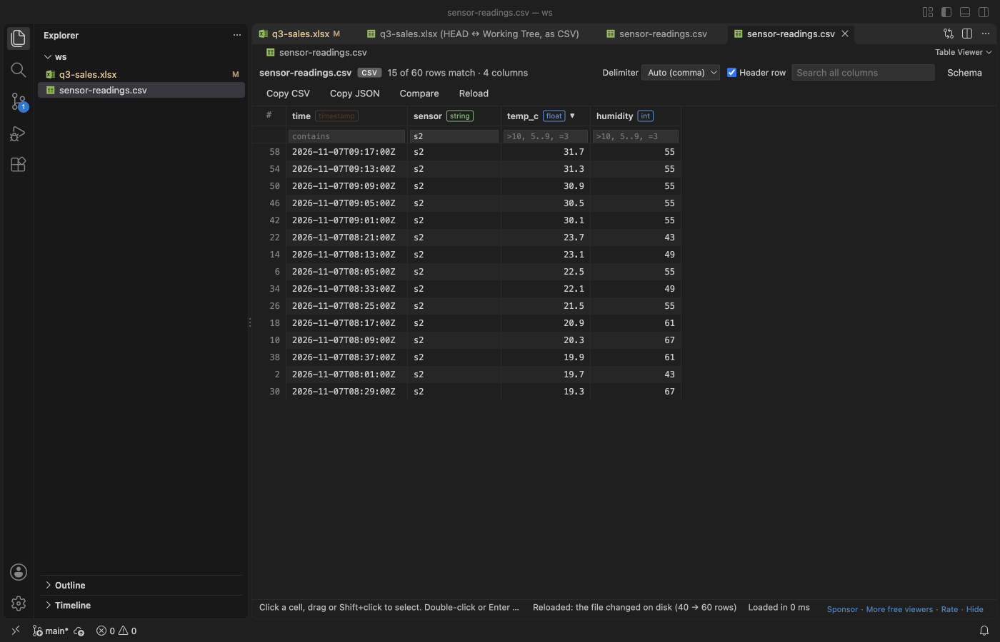

The Schema button shows each column's type. For Parquet it also shows the full schema tree with physical and logical types, plus repetition, row groups, compression, the writer and the key-value metadata.


## Supported files

| Format | Extensions | Opens by default | Reader |
|---|---|---|---|
| Parquet | `.parquet`, `.pq` | yes | hyparquet (MIT), with snappy, gzip, zstd, brotli and lz4 |
| Excel and OpenDocument | `.xlsx`, `.xlsm`, `.xlsb`, `.xls`, `.ods` | yes | SheetJS Community Edition 0.20.3 (Apache-2.0) |
| CSV and TSV | `.csv`, `.tsv`, `.tab`, `.psv` | no, use "Open in Table Viewer" | built-in streaming parser |

CSV files keep opening in the text editor by default, since people edit them as text. The delimiter (comma, tab, semicolon or pipe) is detected from the first lines. When the guess is wrong, for example in a semicolon file whose text has commas in it, pick comma, tab, semicolon, pipe or colon in the toolbar's Delimiter list. Untick "Header row" for a file that has none, and the columns are named column_1, column_2 and so on. Both choices are kept for each file in the workspace. The encoding is detected: UTF-8 and UTF-16 (with or without a byte order mark), Windows-1252 (Excel's "CSV" on Western Windows), Shift_JIS, GB18030, Big5, EUC-KR and Windows-1251. If the text still looks wrong, pick the encoding in the toolbar's Encoding list; the choice is kept for the file. Excel workbooks with several sheets get a sheet picker.

Column types come from the Parquet schema, from Excel cell types, or for CSV from the values themselves (int, float, bool, date, timestamp or string). Integers too large to hold exactly stay as text, so no digits are lost.

## Limits and settings

| Setting | Default | What it does |
|---|---|---|
| `tableViewer.maxRows` | 1,000,000 | Rows to load per file. A banner says when a file has more. |
| `tableViewer.maxFileSizeMB` | 512 | How much of a CSV/TSV file to read, and the size limit for big `.xlsx` and `.xlsm` workbooks, which are streamed. Parquet is read by row group, so only `maxRows` applies. |
| `tableViewer.maxExcelSizeMB` | 50 | `.xls`, `.xlsb`, `.ods` and small `.xlsx` files are read whole. Bigger ones show a message instead of loading. |
| `tableViewer.maxCopyRows` | 100,000 | Most rows copied to the clipboard at once. |
| `tableViewer.autoReload` | true | Reload the table when the file changes on disk. |
| `tableViewer.excelFormats` | true | Show Excel cells with the workbook's number formats. |
| `tableViewer.maxCompareRows` | 100,000 | Rows per table (per sheet) in Compare with Git HEAD and Compare with Another Table File. |
| `tableViewer.queryMemoryMB` | 512 | The most memory one query may keep (groups, the sort buffer, the result and the files read for a JOIN). Rows that are only scanned do not count. A bigger query stops with a message. |
| `tableViewer.askForRating` | true | Ask for a Marketplace rating after 3 files opened without an error on 2 different days. "Later" asks one more time after 7 days, "No thanks" never again. It never asks after an error. Turn it off with `false`. |

On our test machine (Apple Silicon, Node 22), the test suite loads a 1,000,000 row CSV (about 30 MB) in 0.5 s and a 1,000,000 row Parquet file in 0.15 s. It sorts either one by a number column in about 0.2 s and filters in under 0.1 s. Your numbers will differ with the column count and the file.

Table Viewer is read-only. It doesn't edit or save files. Save result and Export write only the new file you pick.

Query limits: one SELECT at a time, no spill to disk (a query past `tableViewer.queryMemoryMB` stops with a message), no RIGHT or FULL JOIN, no WITH and no subqueries inside expressions. In a JOIN every source after the first is read into memory, so put the biggest file first. Other files are read only in a trusted workspace and only from inside the workspace folder.

## Compared with Data Wrangler

Microsoft Data Wrangler is a full data-cleaning tool. It needs a Python environment with pandas and runs a kernel. Table Viewer does less. It shows the file, sorts, filters and copies, and it opens before a kernel would have started. Use Data Wrangler when you need to transform data in Python, and Table Viewer when you just want to look.

## Free

Everything above is free, including SQL queries and JOIN, the SQL filter, column stats and export. There is no paid tier, no trial, no license key to enter and no banner.

## More screenshots

| Parquet, dark theme | Excel, light theme |
|---|---|
| <a href="https://raw.githubusercontent.com/theluckystrike/table-viewer-vscode/main/images/screenshot.png">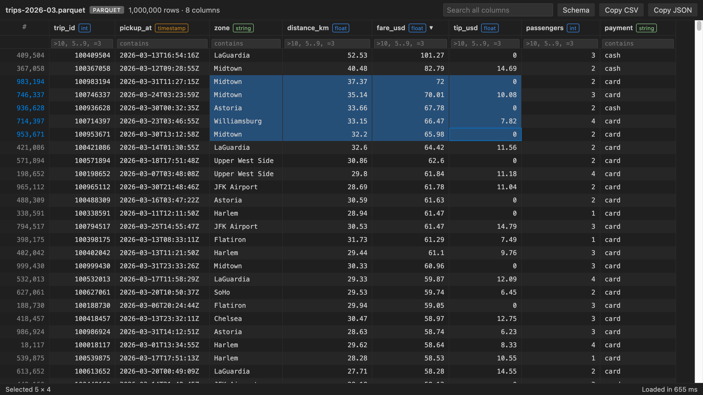</a> | <a href="https://raw.githubusercontent.com/theluckystrike/table-viewer-vscode/main/images/excel-light.png">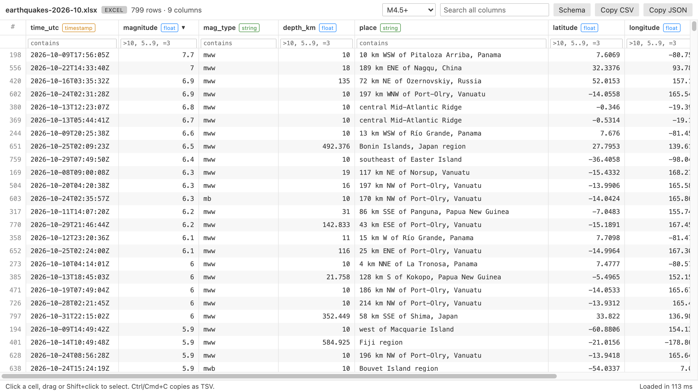</a> |

| Excel number formats, light theme | Auto-reload after a script wrote the CSV |
|---|---|
| <a href="https://raw.githubusercontent.com/theluckystrike/table-viewer-vscode/main/images/vscode-excel-light.png">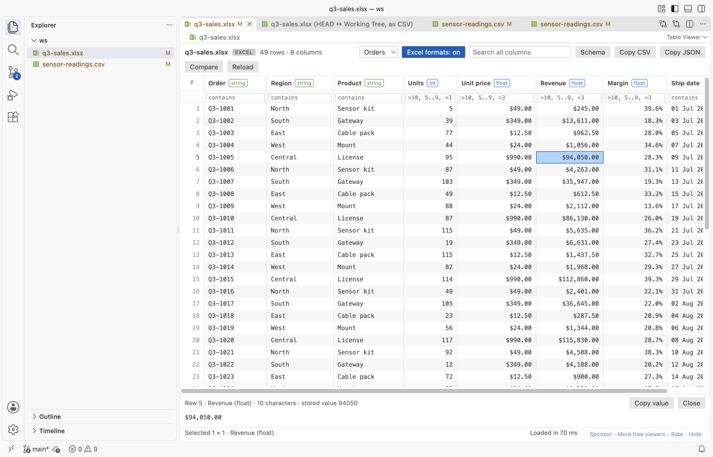</a> | <a href="https://raw.githubusercontent.com/theluckystrike/table-viewer-vscode/main/images/vscode-auto-reload.png"></a> |

| Parquet schema, dark theme | CSV with filters, light theme |
|---|---|
| <a href="https://raw.githubusercontent.com/theluckystrike/table-viewer-vscode/main/images/schema.png">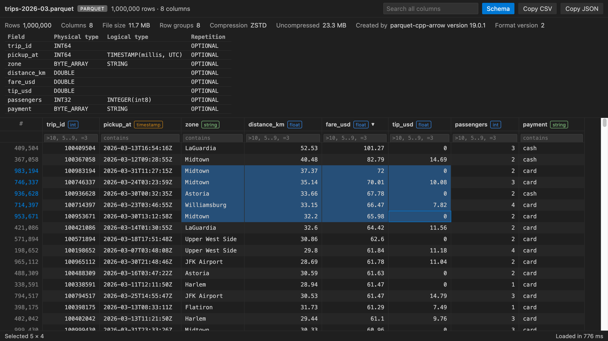</a> | <a href="https://raw.githubusercontent.com/theluckystrike/table-viewer-vscode/main/images/csv-light.png">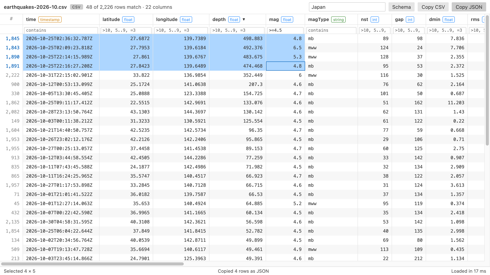</a> |

*Real output, light and dark. The Excel and CSV files hold the real USGS earthquake catalog for October 2026 (2,226 events of magnitude 2.5 or more). The Parquet file is a generated 1,000,000 row taxi-trip table (11.7 MB, zstd). Each shot is the extension's own webview page, with its Content Security Policy, fed by the extension's real reader and message protocol and captured in headless Chrome. The Parquet file loaded in 0.8 s on an M-series Mac.*

## Privacy

Table Viewer makes no network requests and collects no telemetry. Files are read on your machine in a worker thread. The table webview runs under a strict Content Security Policy with no remote scripts, and every value from the file is written as plain text, never as HTML.

## Development

```sh
npm install
npm test          # builds with esbuild, then runs node --test
npm run package   # writes dist/table-viewer-vscode-<version>.vsix
npm run fixtures  # rebuilds test/fixtures (needs python3 with pyarrow)
```

## License

MIT. Bundled third-party licenses are in [THIRD-PARTY-NOTICES.txt](https://github.com/theluckystrike/table-viewer-vscode/blob/HEAD/THIRD-PARTY-NOTICES.txt).

[Rate this extension](https://marketplace.visualstudio.com/items?itemName=zovo.table-viewer-vscode&ssr=false#review-details) on the Marketplace if it saved you time. A rating helps other people find it.

## Support Zovo

Zovo extensions are free, with no ads and no tracking. They are made by [theluckystrike](https://github.com/theluckystrike) on GitHub. If this one saves you time, you can support the work:

- [Sponsor on GitHub](https://github.com/sponsors/theluckystrike)
- [Follow theluckystrike on GitHub](https://github.com/theluckystrike)

## More tools by Zovo

- [SQLite Viewer & DB Viewer, Database Viewer (Read-Only)](https://marketplace.visualstudio.com/items?itemName=zovo.sqlite-table-viewer) browses SQLite tables read-only and runs SELECT queries.
- [JSONL Viewer, Large JSONL Table & NDJSON Viewer](https://marketplace.visualstudio.com/items?itemName=zovo.zovo-jsonl-viewer) opens JSONL and NDJSON files as a table, as records or as a chat view.
- [Avro Viewer, Apache Arrow Viewer & Feather Viewer](https://marketplace.visualstudio.com/items?itemName=zovo.arrow-avro-viewer) opens Avro, Arrow and Feather files as a paged table.
- [Large JSON Viewer, JSON Browser & JSON Tree](https://marketplace.visualstudio.com/items?itemName=zovo.zovo-json-tree-viewer) shows large JSON files as a searchable tree, copies JSONPath and turns arrays of objects into a table.
- [DOCX Viewer, Word Viewer & DOCX Preview (Dark Mode)](https://marketplace.visualstudio.com/items?itemName=zovo.docx-viewer-vscode) previews Word and ODT files with dark mode, an outline and search.

See [all Zovo extensions on the Marketplace](https://marketplace.visualstudio.com/publishers/zovo).

## More from zovo

- [All free zovo VS Code extensions](https://marketplace.visualstudio.com/publishers/zovo) — file viewers, database clients, formatters. Offline, no telemetry, no sign-up.
- [Full MCP server catalogue](https://theluckystrike.github.io/mcp/) — local-first MCP servers for back-office work: invoices, VAT, PDFs, spreadsheets, payroll.
- [Hosted no-install MCP endpoints](https://mcp.zovo.one) — paste a URL in Claude / Cursor, nothing to install.
